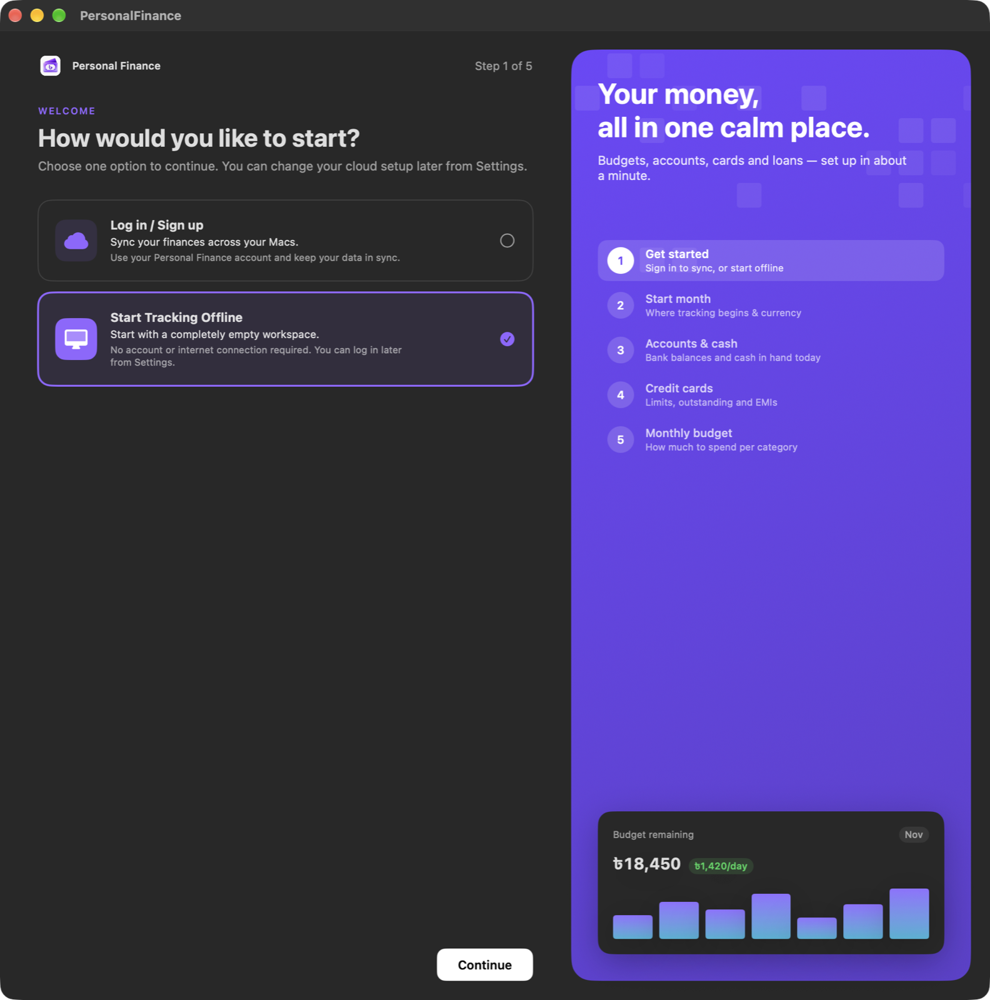
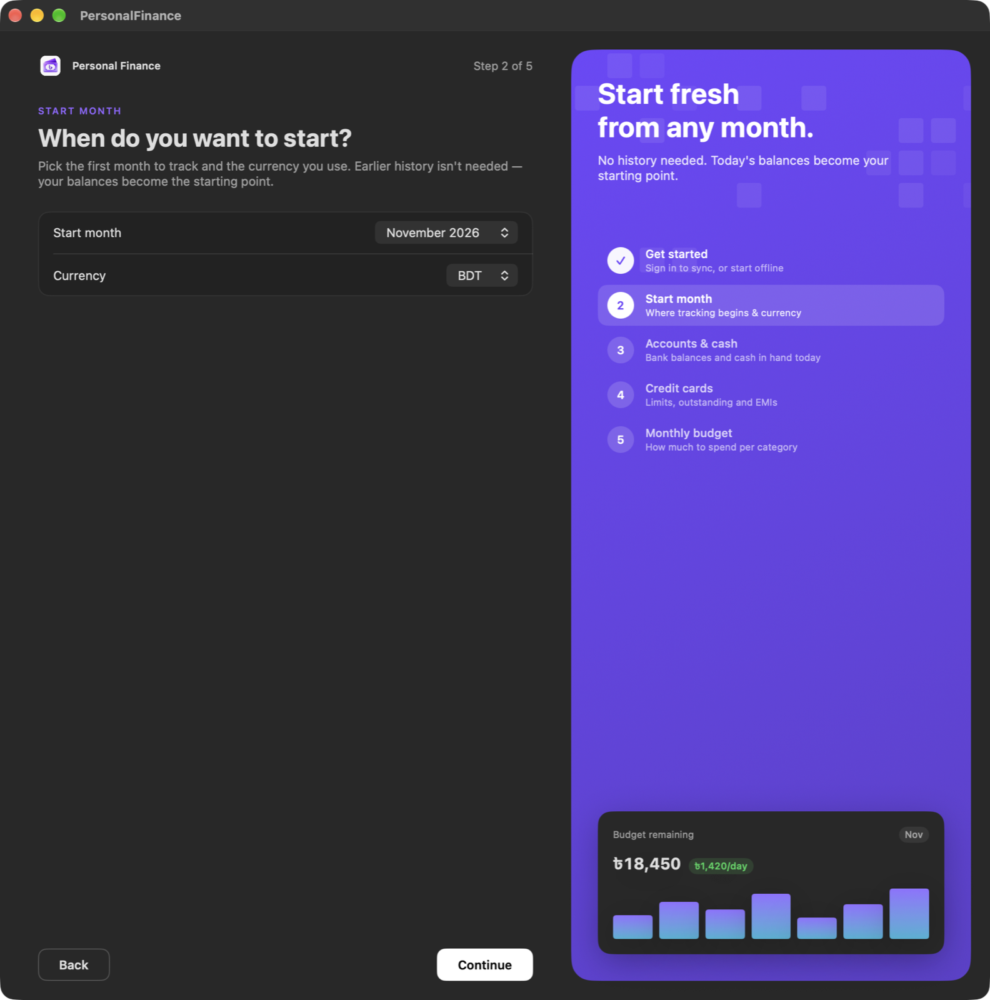
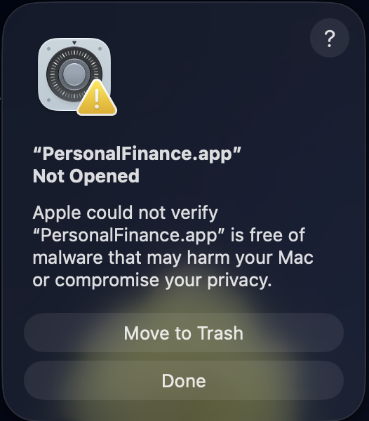
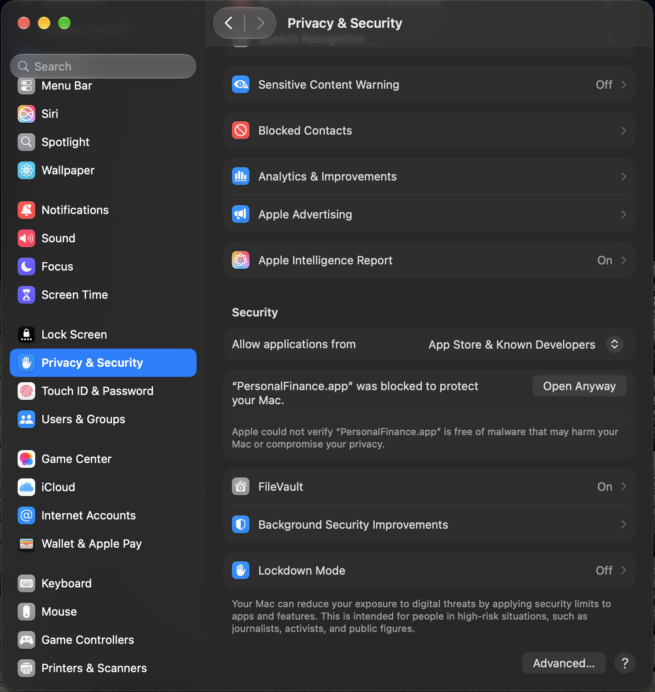

<div align="center">

# Personal Finance

**A calm, focused money workspace for macOS + Web.**

Budgets, accounts, credit cards, EMIs and loans — in one place, without spreadsheet clutter.

<br>

[](../../releases)
[](../../releases)
[](../../releases)
[](https://personalfinance-webapp.vercel.app/)

**[📦 Download for macOS](../../releases/latest)** · **[🚀 Open Web App](https://personalfinance-webapp.vercel.app/)**

<br>


<sub>All screenshots use sample data.</sub>

</div>

---

## Why Personal Finance

- **Know what's left.** Budget Remaining counts only your budgeted spending, with a per-day "safe to spend" figure for the rest of the month.
- **Credit cards done right.** Available credit accounts for posted spend, pending purchases *and* future EMI installments.
- **Fast to keep up to date.** Quick Add with ⌘N, remembered accounts and categories, and amounts like `1.5k`, `2L` or `120+80`.
- **Yours, offline first.** Everything works without an account; cloud sync is optional.

---

## A tour

### Dashboard
Income, expense and budget remaining with month-over-month change, total assets, net available money, spending by category and budget vs actual for every category (pictured at the top).

### Transactions
Grouped by day, week or month. Filter by type, account or category, see pending card purchases at a glance, double-click any row for full details, and select several rows to recategorise or delete them together.


### Monthly Budget
Every category with its plan, spending, remaining amount and a progress bar. Change a single month without touching the Master Budget.


### Credit cards & EMIs
"This Statement" shows what was billed, what's still to pay and how many days until it's due, with an optional reminder. EMIs track remaining installments and the credit they reserve; finished EMIs are archived under their card.


### Reports
Category breakdown, a six-month income trend, net available money over time, and a one-click PDF export.


### Invoicing (optional)
Switch on **Business mode** in Settings to add Invoices and Clients. Bill in any currency with hours, days or other units per line; the app shows each invoice in your own currency, and exports a clean multi-page PDF with your bank details and signature.

---

## Getting started in a minute

A short guided setup gets your starting position in place — every step after the first two can be skipped and filled in later.

<table>
<tr>
<td width="50%"><br><sub><b>1 · Welcome</b> — sign in to sync, or start offline.</sub></td>
<td width="50%"><br><sub><b>2 · Start month</b> — choose where tracking begins and your currency.</sub></td>
</tr>
<tr>
<td><br><sub><b>3 · Accounts &amp; cash</b> — bank balances and cash in hand become opening balances.</sub></td>
<td><br><sub><b>4 · Credit cards</b> — limit, outstanding, billing cycle and existing EMIs.</sub></td>
</tr>
<tr>
<td colspan="2" align="center"><br><sub><b>5 · Budget</b> — start from a suggested budget and adjust.</sub></td>
</tr>
</table>

---

## macOS & Web

| | macOS | Web |
|---|:---:|:---:|
| Dashboard | ✓ | ✓ |
| Transactions & Income | ✓ | ✓ |
| Budgets | ✓ | ✓ |
| Accounts & Savings | ✓ | ✓ |
| Loans & Credit Cards | ✓ | ✓ |
| EMI & Transfers | ✓ | ✓ |
| Reports | ✓ | ✓ |
| Cloud Sync | ✓ | ✓ |
| Offline Tracking | ✓ | — |
| Backup & Restore | ✓ | ✓ |
| Invoicing | ✓ | — |

---

## Credit Card Logic

Available credit accounts for obligations that have already been posted **and** commitments that have not settled yet:

```text
Available Credit
= Credit Limit
− Current Outstanding
− Unsettled / Pending Card Purchases
− Remaining EMI Amount
```

This keeps pending purchases and future EMI obligations from appearing as freely available credit.

---

## Install on macOS

1. Download **`PersonalFinance-v1.18.dmg`** from the [latest release](../../releases/latest).
2. Open it and drag **PersonalFinance** into **Applications**.
3. Open the app. The first time, macOS Gatekeeper may ask you to confirm:
   go to **System Settings → Privacy & Security**, click **Open Anyway** for PersonalFinance, then confirm.

<div align="center">

<table>
<tr>
<td align="center"></td>
<td align="center"></td>
<td align="center"></td>
</tr>
</table>

</div>

> **Security note:** Only bypass Gatekeeper when the app came from a release source you trust. The warning means macOS could not verify the app through its available trust mechanism; it does not by itself identify the app as malware.

**Keyboard shortcuts:** ⌘N add expense · ⌘1–9 switch pages · ⌘← / ⌘→ change month · ⌘F search · Delete removes selected transactions.

---

## Releases

| Version | Highlights |
|---|---|
| **v1.18 · Build 146** | New look with brand purple, redesigned onboarding, consistent lists across the app, transaction details on double-click, statement summary for cards, PDF reports, invoicing with clients and multi-currency PDF invoices, clock-style time picker, single-page Settings with live sync status. |
| v1.0 · Build 125 | First production release. |

**[All releases →](../../releases)**

---

## Privacy

This public repository contains **product documentation and release information — not application source code or private financial data**. Screenshots use sample data only.

Never publish passwords, API keys, authentication tokens, bank/card numbers, transaction exports or private database files.

---

## Support

Found a bug or have a feature request? Open a GitHub Issue with:

- Platform + app version/build
- Steps to reproduce
- Expected vs actual behavior
- Screenshot or recording when useful

Please remove private financial information before posting.

---

<div align="center">

**Personal Finance · v1.18 Build 146**

[Web App](https://personalfinance-webapp.vercel.app/) · [Releases](../../releases) · [Issues](../../issues)

</div>
