<div align="center">

# Personal Finance

**A calm, focused money workspace for macOS + Web.**

Budgets, accounts, credit cards, EMIs, loans and invoices — in one place, without spreadsheet clutter.

<br>

[](../../releases)
[](../../releases)
[](../../releases)
[](https://personalfinance-webapp.vercel.app/)

**[📦 Download for macOS](../../releases/latest)** · **[🚀 Open Web App](https://personalfinance-webapp.vercel.app/)**

<br>

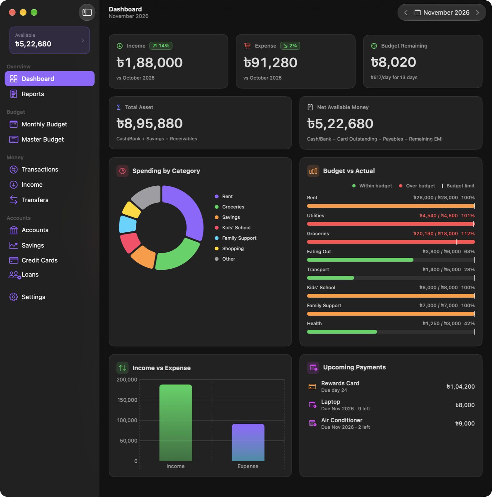

<sub>All screenshots are from v1.19 and use made-up sample data.</sub>

</div>

---

## Why Personal Finance

- **Know what's left.** Budget Remaining counts only your budgeted spending, with a per-day "safe to spend" figure for the rest of the month.
- **Credit cards done right.** Available credit accounts for posted spend, pending purchases *and* future EMI installments.
- **Fast to keep up to date.** Quick Add with ⌘N, remembered accounts and categories, and amounts like `1.5k`, `2L` or `120+80`.
- **Bill your clients too.** Optional Business mode adds invoices and clients in any currency, with PDF invoices you can send by email or WhatsApp.
- **Yours, offline first.** Everything works without an account; cloud sync is optional.

---

## All features

### Dashboard
- Income and Expense with month-over-month change pills; Budget Remaining with "৳X/day for N days".
- Expense and Budget Remaining use only this month's Monthly Budget categories — off-budget spending is never counted.
- Total Asset (cash/bank + savings + receivables) and Net Available Money (after card outstanding, payables and remaining EMIs).
- Spending by Category donut — hover a slice to see its amount and share.
- Budget vs Actual for every category, with a budget-limit marker, orange at 90% and red when over.
- Income vs Expense chart and Upcoming Payments (card dues and EMIs).

### Transactions, Income & Transfers
- One consistent list: grouped by day (or week / month) with daily spend totals, type icon, title and account details.
- Filters by type, account and category; search with ⌘F.
- Pending-settlement strip for card purchases that haven't posted yet.
- Double-click any row for a details popup; right-click for more.
- ⌘/⇧-click to select several rows, then change their category or delete them together; Undo after deleting.
- Duplicate an entry for review; possible-duplicate warning when the same amount was added twice.


### Budgets
- **Master Budget:** your default monthly plan, grouped by category type, with share of total; archive categories you no longer use.
- **Monthly Budget:** every category with plan, spent, remaining, % used, status and a progress bar. Change one month without touching the Master Budget, or add a category for this month only.
- Optional rollover of unspent budget into the next month; notifications at 90% and 100%.

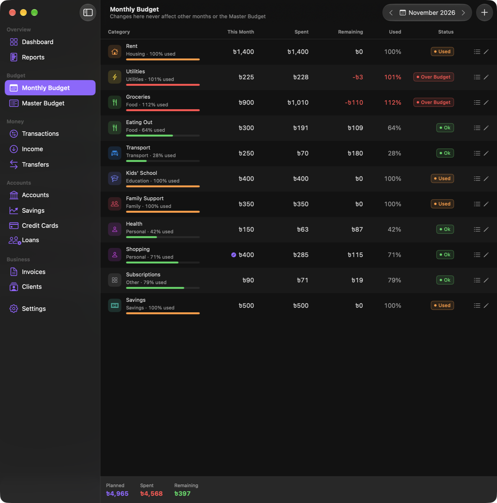

### Accounts, Savings & Loans
- Bank, mobile-wallet and cash accounts with opening balances; multi-currency wallets.
- Savings / DPS with monthly plan, target and progress; deposits from any account.
- Loans you gave and took, repayments, repay dates and WhatsApp reminders; settled loans archived.
- Balance adjustment and reconcile tools.

### Credit cards & EMIs
- "This Statement": billed amount, still to pay, estimated minimum, due countdown and an optional reminder 3 days before.
- Limit, outstanding, available credit, pending purchases and utilisation.
- EMIs per card with remaining installments and reserved credit; convert a purchase to EMI; finished EMIs archived under the card.

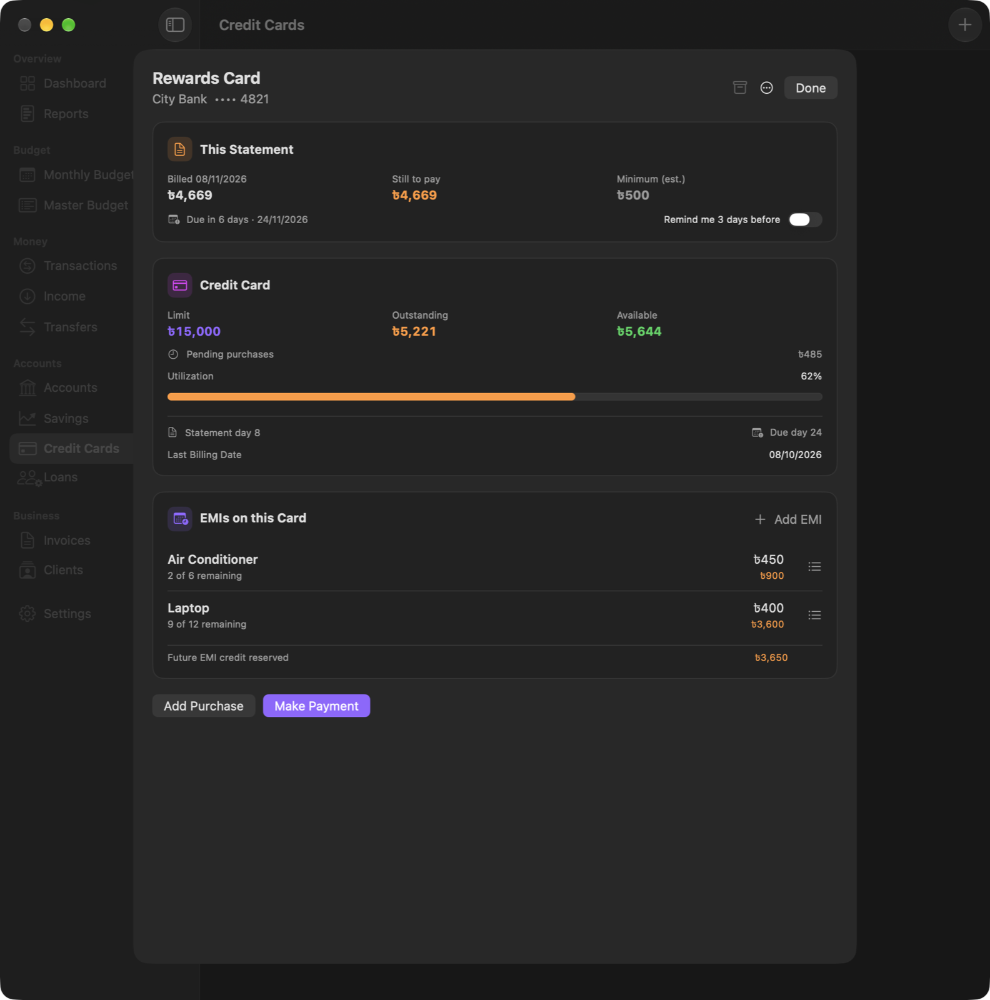

### Reports
- Monthly summary, category breakdown, six-month income trend and Net Available Money over time.
- One-click PDF export.

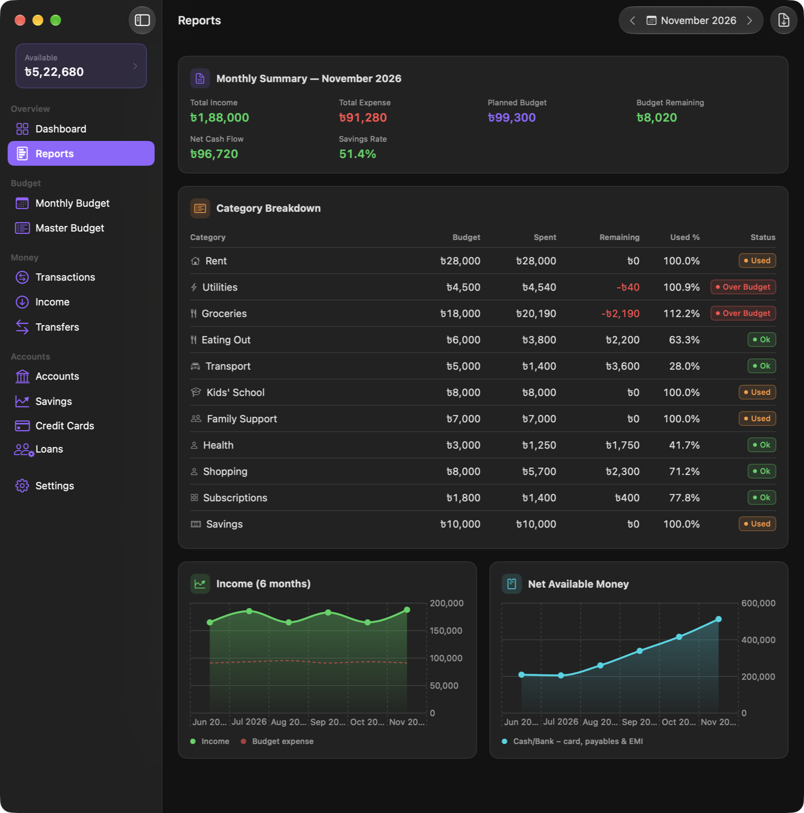

### Invoicing (Business mode)
Switch on **Business mode** in Settings to add **Invoices** and **Clients**.

- Bill in any currency, with hours, days, sessions or other units per line, discount and tax.
- Each invoice shows its value in your own currency at today's rate; the totals (Outstanding, Overdue, Received this month) can be shown in USD, BDT, EUR, GBP and more.
- **Several receiving accounts** (e.g. a USD account and a local bank account): mark one as default and pick one per invoice from a dropdown; the PDF prints that account's bank details.
- Clean, multi-page PDF invoices with your business details and signature.
- **Send by Email** (Mail opens with the PDF attached) or **on WhatsApp** (the client's chat opens with a ready message; the PDF is copied to paste in).
- **Mark as Paid** records the payment in Income, in the account the money arrived in.
- Clients show what you billed and what's unpaid in their own currency; double-click a client for a preview of their details and every invoice.
- Business mode, your business details, receiving accounts, clients and invoices sync to your other Macs.

<table>
<tr>
<td width="50%">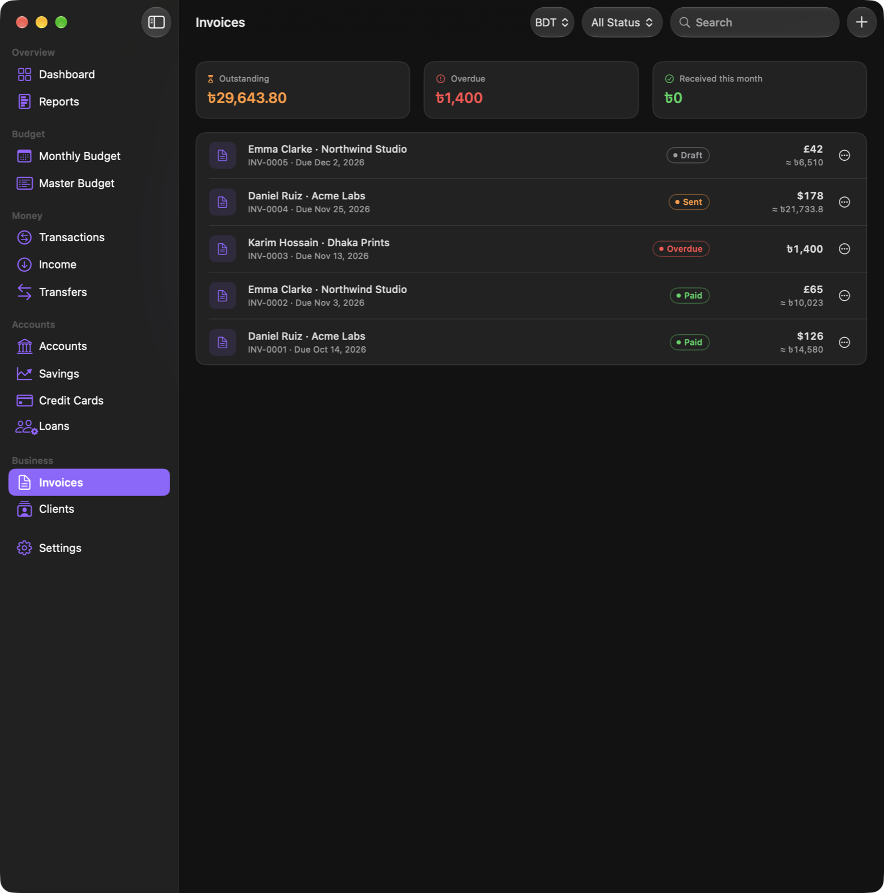<br><sub><b>Invoices</b> — status, amounts and totals in your chosen currency.</sub></td>
<td width="50%">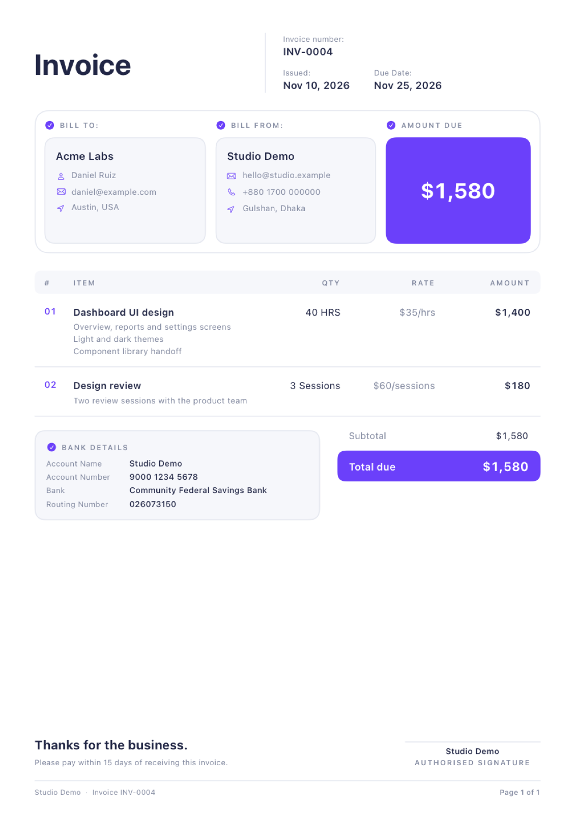<br><sub><b>PDF invoice</b> — bank details from the chosen receiving account.</sub></td>
</tr>
<tr>
<td><br><sub><b>Clients</b> — billed and unpaid in the client's currency.</sub></td>
<td>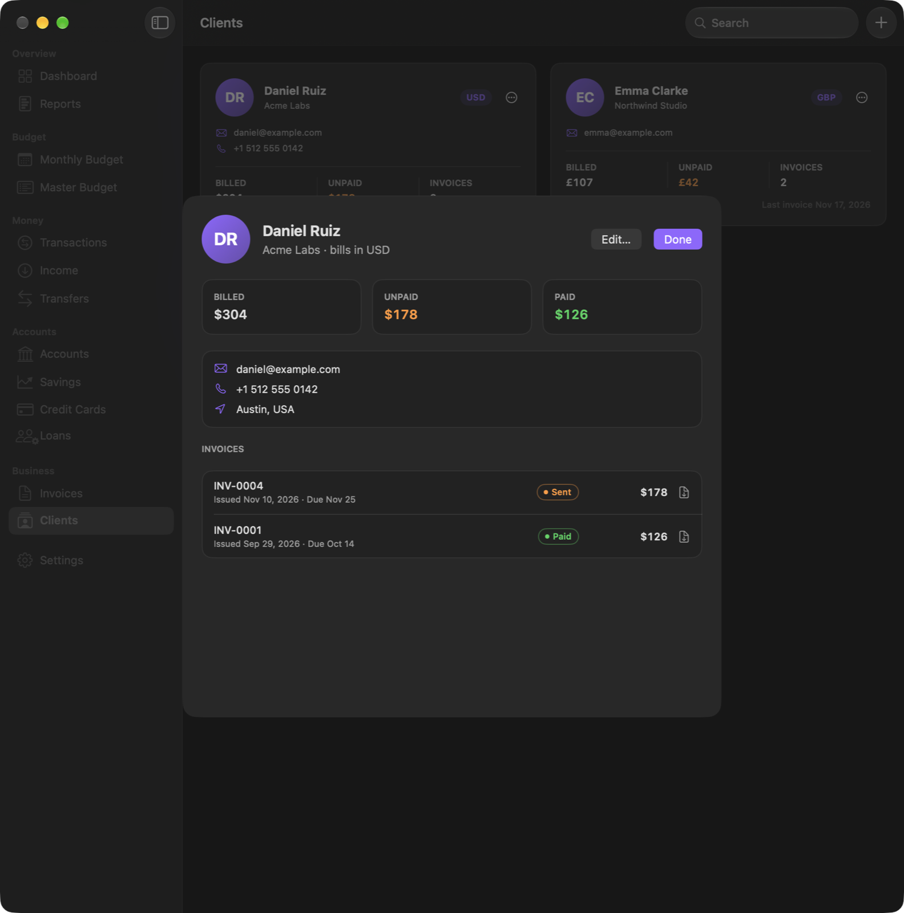<br><sub><b>Client preview</b> — double-click a client.</sub></td>
</tr>
<tr>
<td colspan="2" align="center">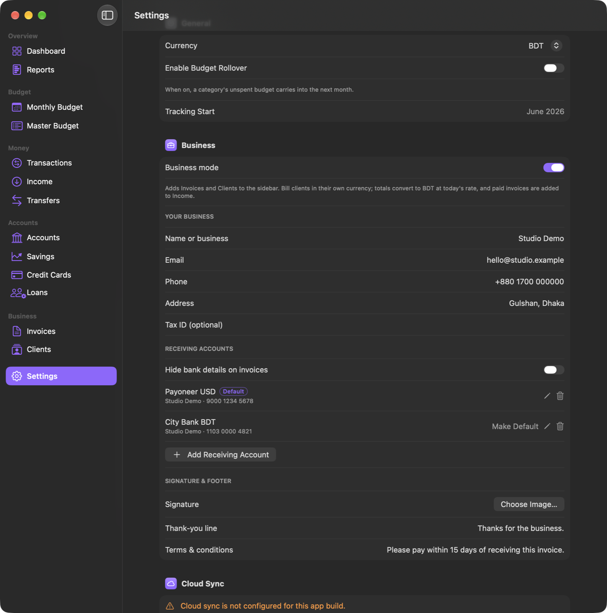<br><sub><b>Settings › Business</b> — your details and receiving accounts.</sub></td>
</tr>
</table>

### Settings, sync & backup
- Single-page Settings with live sync status, currency, tracking start month and tools.
- Optional cloud sync (Supabase) across Macs and the web app; works fully offline without an account.
- Backup and restore to a file; daily reminder with a clock-style time picker.

---

## Getting started in a minute

A short guided setup gets your starting position in place — every step after the first two can be skipped and filled in later.

<table>
<tr>
<td width="50%"><br><sub><b>1 · Welcome</b> — sign in to sync, or start offline.</sub></td>
<td width="50%"><br><sub><b>2 · Start month</b> — where tracking begins and your currency.</sub></td>
</tr>
<tr>
<td>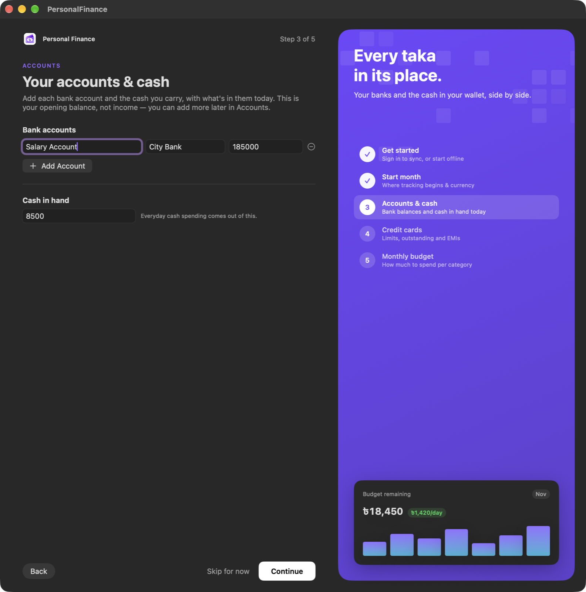<br><sub><b>3 · Accounts &amp; cash</b> — today's balances become opening balances.</sub></td>
<td>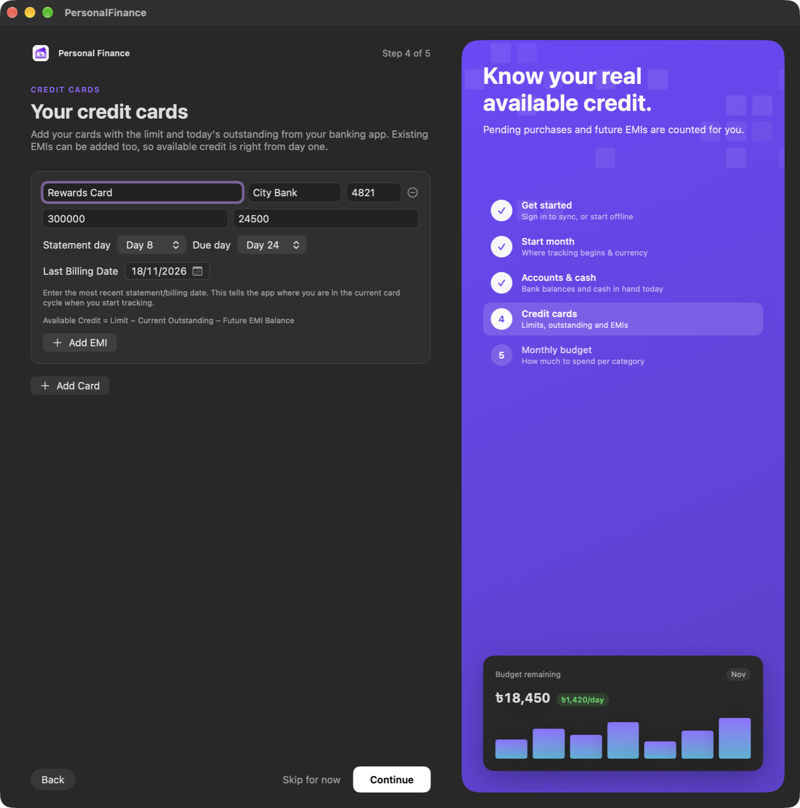<br><sub><b>4 · Credit cards</b> — limit, outstanding, billing cycle and existing EMIs.</sub></td>
</tr>
<tr>
<td colspan="2" align="center">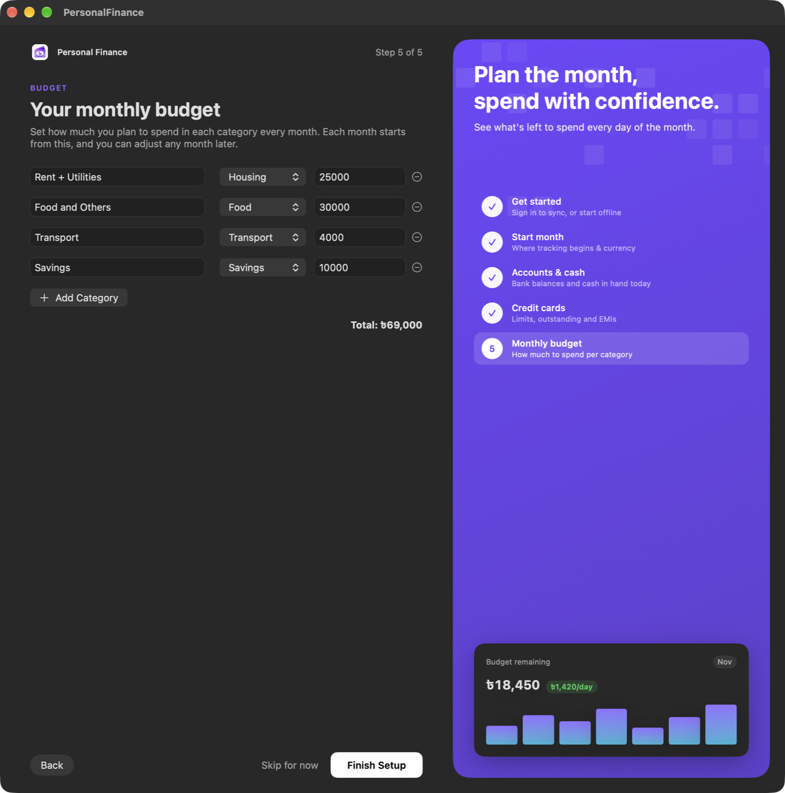<br><sub><b>5 · Budget</b> — start from a suggested budget and adjust.</sub></td>
</tr>
</table>

---

## macOS & Web

| | macOS | Web |
|---|:---:|:---:|
| Dashboard | ✓ | ✓ |
| Transactions & Income | ✓ | ✓ |
| Budgets | ✓ | ✓ |
| Accounts & Savings | ✓ | ✓ |
| Loans & Credit Cards | ✓ | ✓ |
| EMI & Transfers | ✓ | ✓ |
| Reports | ✓ | ✓ |
| Cloud Sync | ✓ | ✓ |
| Offline Tracking | ✓ | — |
| Backup & Restore | ✓ | ✓ |
| Invoicing & Clients | ✓ | — |

---

## Credit Card Logic

Available credit accounts for obligations that have already been posted **and** commitments that have not settled yet:

```text
Available Credit
= Credit Limit
− Current Outstanding
− Unsettled / Pending Card Purchases
− Remaining EMI Amount
```

This keeps pending purchases and future EMI obligations from appearing as freely available credit.

---

## Install on macOS

1. Download **`PersonalFinance-v1.19.dmg`** from the [latest release](../../releases/latest).
2. Open it and drag **PersonalFinance** into **Applications**.
3. Open the app. The first time, macOS Gatekeeper may ask you to confirm:
   go to **System Settings → Privacy & Security**, click **Open Anyway** for PersonalFinance, then confirm.

<div align="center">

<table>
<tr>
<td align="center"></td>
<td align="center"></td>
<td align="center">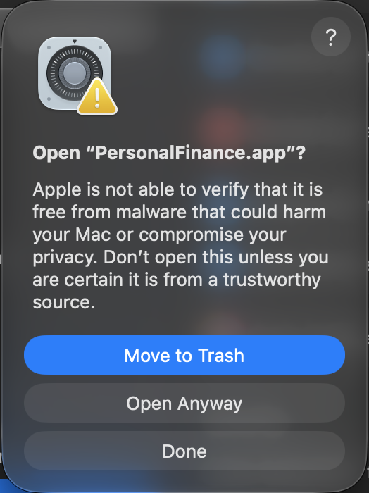</td>
</tr>
</table>

</div>

> **Security note:** Only bypass Gatekeeper when the app came from a release source you trust. The warning means macOS could not verify the app through its available trust mechanism; it does not by itself identify the app as malware.

**Keyboard shortcuts:** ⌘N add expense · ⌘1–9 switch pages · ⌘← / ⌘→ change month · ⌘F search · Delete removes selected transactions.

---

## Releases

| Version | Highlights |
|---|---|
| **v1.19 · Build 147** | Several receiving accounts per business, invoice totals in any currency, send invoices by email or WhatsApp, Mark as Paid adds to Income, business data syncs across Macs, redesigned clients with preview, cleaner invoice form and PDF, full-height credit card popup. |
| v1.18 · Build 146 | New look with brand purple, redesigned onboarding, consistent lists, transaction details on double-click, statement summary for cards, PDF reports, invoicing with clients and multi-currency PDF invoices. |
| v1.0 · Build 125 | First production release. |

**[All releases →](../../releases)**

---

## Privacy

This public repository contains **product documentation and release information — not application source code or private financial data**. Screenshots use made-up sample data only.

Never publish passwords, API keys, authentication tokens, bank/card numbers, transaction exports or private database files.

---

## Support

Found a bug or have a feature request? Open a GitHub Issue with:

- Platform + app version/build
- Steps to reproduce
- Expected vs actual behavior
- Screenshot or recording when useful

Please remove private financial information before posting.

---

<div align="center">

**Personal Finance · v1.19 Build 147**

[Web App](https://personalfinance-webapp.vercel.app/) · [Releases](../../releases) · [Issues](../../issues)

</div>
