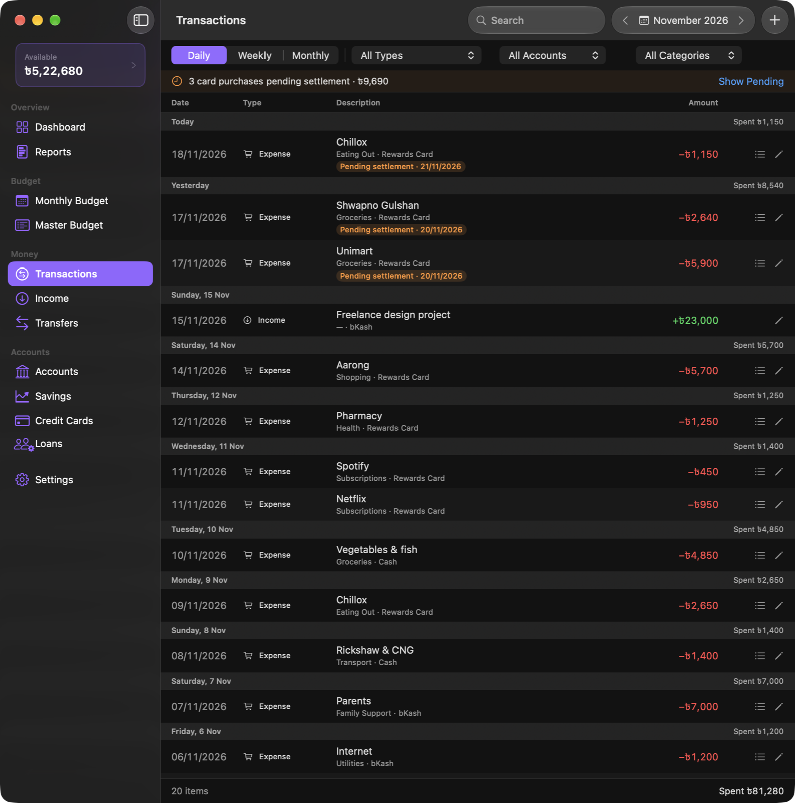
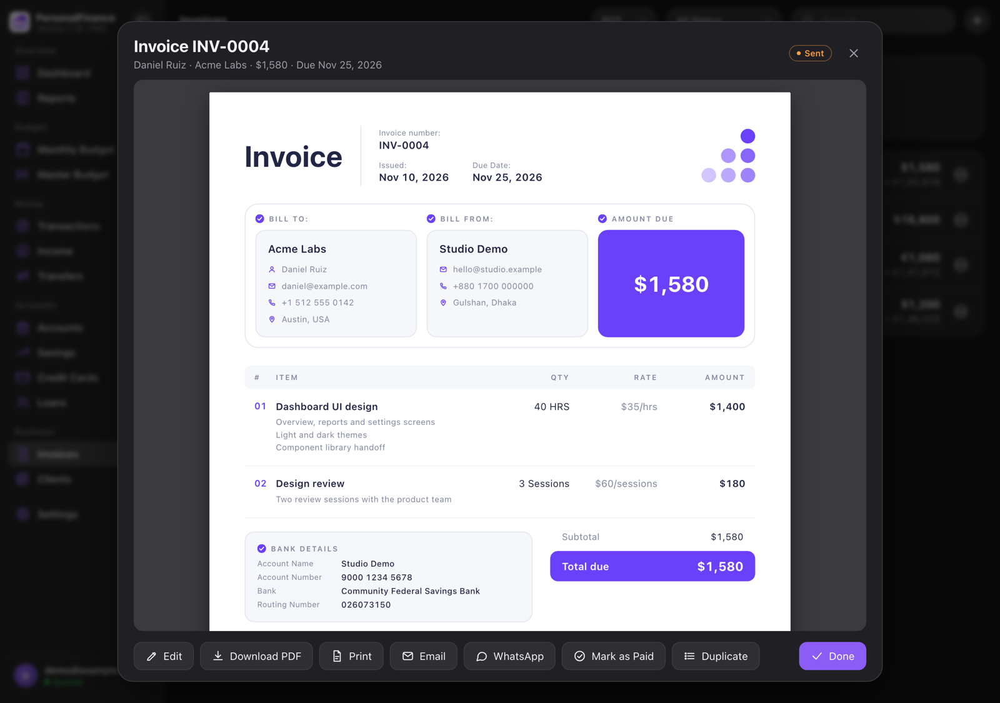
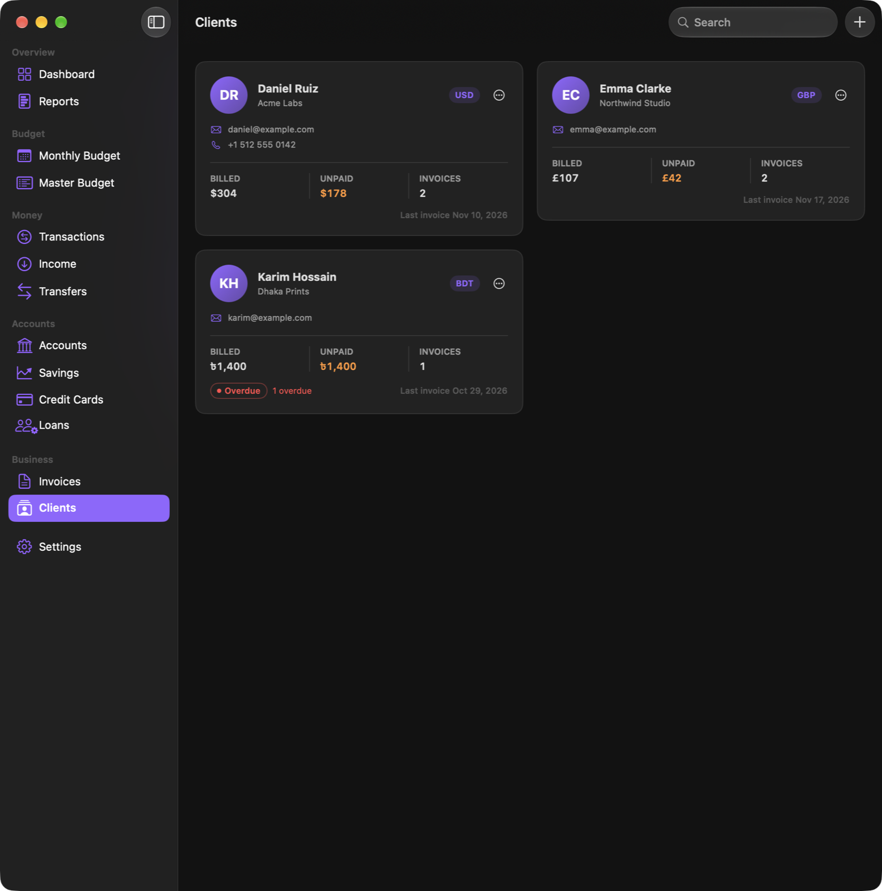

# Personal Finance

### Your money, calm and clear — on Mac and the web.

Budgets · Accounts · Credit cards & EMIs · Loans · Invoices

 

&nbsp;

v1.19 · Build 148 · macOS 14+ · Screenshots use sample data

 

<table>
<tr>
<td width="33%" valign="top"><h3>🎯 Know what's left</h3>Budget remaining with a daily "safe to spend" figure, and budget vs actual for every category.</td>
<td width="33%" valign="top"><h3>💳 Cards done right</h3>Available credit after pending purchases and future EMIs. Statement, due date and reminder.</td>
<td width="33%" valign="top"><h3>⚡ Fast to keep up</h3>⌘N quick add, remembered accounts, and amounts like <code>1.5k</code>, <code>2L</code> or <code>120+80</code>.</td>
</tr>
<tr>
<td valign="top"><h3>🧾 Bill your clients</h3>Invoices in any currency with rich descriptions, a live preview and one-click PDF, email or WhatsApp.</td>
<td valign="top"><h3>☁️ Synced everywhere</h3>Mac and web share one account. Works fully offline on the Mac.</td>
<td valign="top"><h3>🔒 Private</h3>Your data stays in your own account. No ads, no tracking.</td>
</tr>
</table>

## A quick look

<table>
<tr>
<td width="50%">
<b>Transactions</b> — grouped, filtered, multi-select
</td>
<td width="50%">
<b>Monthly Budget</b> — plan, spent and progress
</td>
</tr>
<tr>
<td>
<b>Credit cards</b> — statement, EMIs, reserved credit
</td>
<td>
<b>Reports</b> — trends and PDF export
</td>
</tr>
<tr>
<td>
<b>Invoice preview</b> — download, print, email, WhatsApp
</td>
<td>
<b>Clients</b> — billed and unpaid in their currency
</td>
</tr>
</table>

## What's new in 1.19

- **Rich item descriptions** — bold, italic, underline, lists, quotes and links.
- **Invoice preview** — press *Next* to see the finished invoice, then download, print or send it.
- **Safer sync** — your business details can never be wiped by an empty sync.
- Several receiving accounts, totals in any currency, and Mark as Paid adds to Income.

[Full release notes →](../../releases)

## Install

1. Download **`PersonalFinance-v1.19.dmg`** from the [latest release](../../releases/latest).
2. Drag **PersonalFinance** into **Applications** and open it.

<b>macOS says it can't verify the app?</b>

 

Open **System Settings → Privacy & Security**, click **Open Anyway** next to PersonalFinance, then confirm.

Only do this for downloads from this repository's releases.

<b>Keyboard shortcuts</b>

 

| | |
|---|---|
| ⌘N | Add expense |
| ⌘1–9 | Switch pages |
| ⌘← / ⌘→ | Previous / next month |
| ⌘F | Search |
| ⌘B ⌘I ⌘U | Bold, italic, underline in descriptions |

---

This repository holds releases and documentation, not source code or financial data. Found a bug? <a href="../../issues">Open an issue</a> — please leave out personal financial details.

